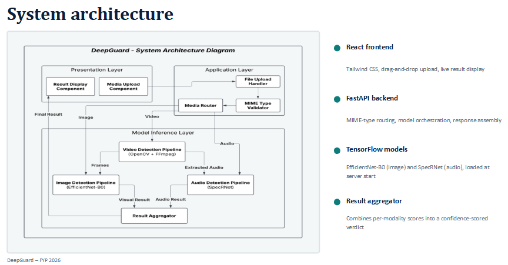
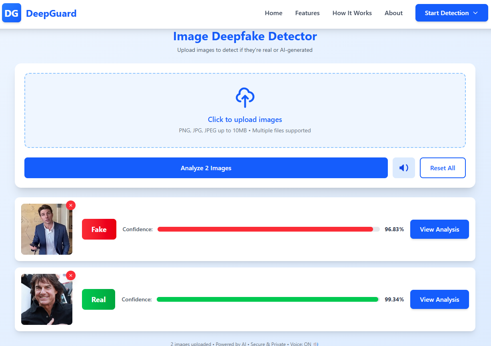
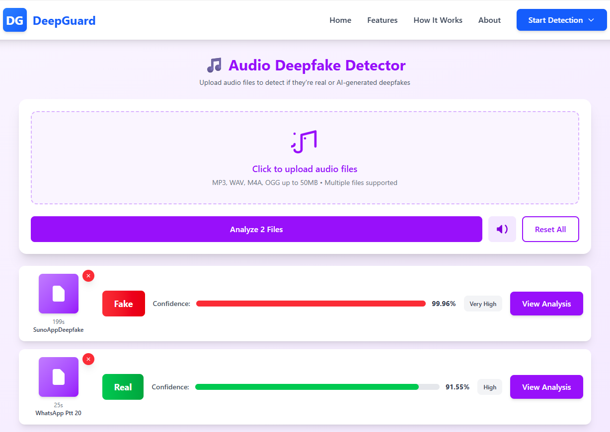
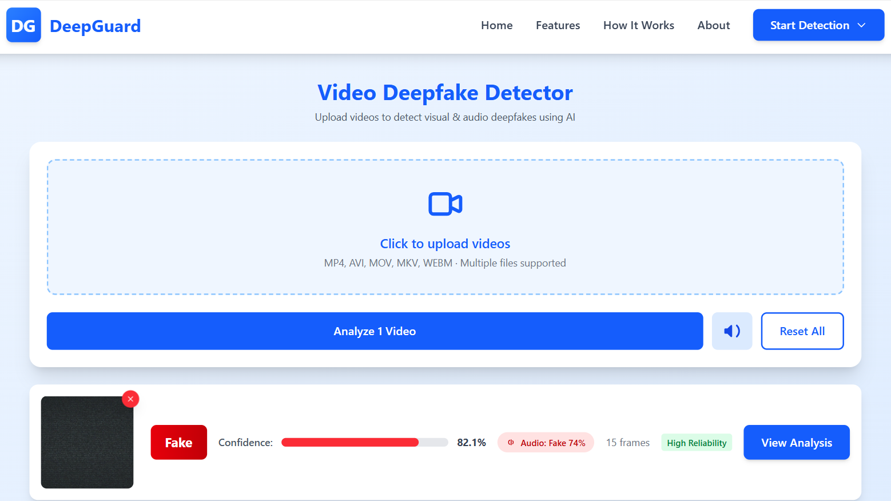
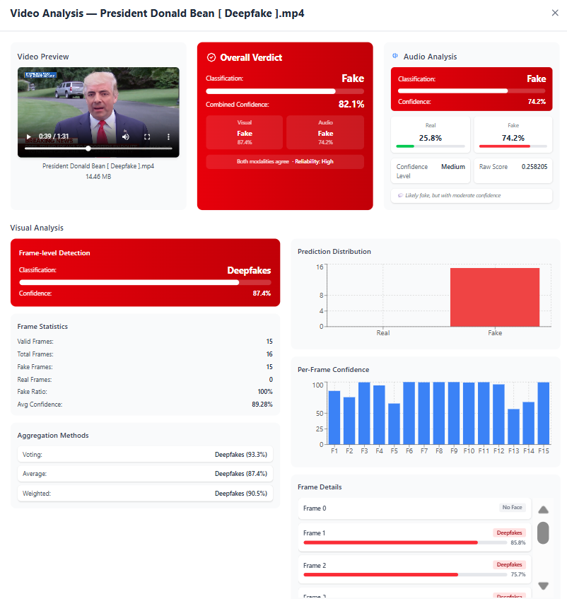

<div align="center">

# DeepGuard

### Multi-Modal Deepfake Detection for Images, Audio and Video


*Final Year Project, BS Software Engineering, COMSATS University Islamabad, Lahore Campus (2026)*


</div>

DeepGuard analyses uploaded **images, audio clips and videos**, decides whether they are real or manipulated, and explains each verdict with confidence scores, per-class probabilities and frame-level detail. A FastAPI service runs the models, a React interface presents the results, and a chatbot answers questions about spotting deepfakes.

## Contents

- [Highlights](#highlights)
- [System architecture](#system-architecture)
- [Screenshots](#screenshots)
- [Model performance](#model-performance)
- [How video verdicts are made](#how-video-verdicts-are-made)
- [API reference](#api-reference)
- [Getting started](#getting-started)
- [Project structure](#project-structure)
- [Limitations](#limitations)

## Highlights

- **Three modalities, one service:** images, audio and video share a single FastAPI backend with automatic file-type routing.
- **Six-class image classifier:** separates real faces from five manipulation methods (Deepfakes, Face2Face, FaceSwap, FaceShifter, NeuralTextures), reaching **92.27% test accuracy**.
- **Audio detector:** a SpecRNet-style residual CNN with attention on log-mel spectrograms, reaching **0.9737 ROC AUC**.
- **Video analysis:** 16 sampled frames go through the image model, and the audio track goes through the audio model. The two results are combined into one verdict.
- **Explainable output:** class probabilities, per-frame confidence charts and image feature-quality indicators.
- **Reproducible:** both training notebooks are included in [`notebooks/`](notebooks/).

## System architecture



```
React + Tailwind frontend  ──upload──▶  FastAPI backend
                                          ├─ image  : Haar-cascade face crop → EfficientNet-B0 → class + probabilities
                                          ├─ audio  : log-mel spectrogram → SpecRNet-style CNN → real / fake
                                          ├─ video  : 16 frames → image model (aggregated) + extracted audio → audio model
                                          └─ chat   : Groq-hosted LLM for deepfake-awareness Q&A
```

## Screenshots

| Image detector | Audio detector |
|:---:|:---:|
|  |  |

| Video detector | Video analysis |
|:---:|:---:|
|  |  |

## Model performance

| Modality | Model | Test result |
|---|---|---|
| Image | EfficientNet-B0 (ImageNet weights), 6 classes | **92.27% accuracy · 0.923 macro F1** (1,152 test images) |
| Audio | SpecRNet-style residual CNN with attention | **0.9737 ROC AUC · 91.36% accuracy · 8.7% EER** (5,984 test clips) |
| Video | Image model on 16 frames + audio model on the soundtrack | Combined verdict (see below) |

<details>
<summary><b>Image model: training details</b></summary>

- **Data:** balanced subset of 6,000 FaceForensics++ frames (1,000 per class), stratified 64 / 16 / 20 train / validation / test split.
- **Classes:** Real, Deepfakes, Face2Face, FaceSwap, FaceShifter, NeuralTextures. Real is the weakest class (F1 0.830); the others score between 0.893 and 0.966.
- **Preprocessing:** Haar-cascade face crop, resize to 224 × 224, EfficientNet preprocessing, horizontal-flip augmentation.
- **Training:** Adam (learning rate 0.001), 20 epochs, batch size 64, dropout 0.6, ReduceLROnPlateau, best-checkpoint selection on validation accuracy.
- **Notebook:** [`notebooks/image_efficientnetb0_training.ipynb`](notebooks/image_efficientnetb0_training.ipynb)

</details>

<details>
<summary><b>Audio model: training details</b></summary>

- **Data:** 30,000 clips (15,000 real, 15,000 fake), 4-second segments at 16 kHz.
- **Features:** 128-band log-mel spectrograms (FFT 2048, hop 512), normalised to [0, 1].
- **Model:** residual convolutional blocks with attention, trained from scratch in Keras (about 2.86 million parameters).
- **Training:** Adam (learning rate 3e-5, gradient clipping), early stopping, learning-rate reduction. The reported accuracy uses the threshold that maximised F1 on the test set (0.41).
- **Notebook:** [`notebooks/audio_specrnet_training.ipynb`](notebooks/audio_specrnet_training.ipynb)

</details>

## How video verdicts are made

1. **Frames:** 16 frames are sampled across the video (skipping the first and last 10%) and passed through the image model. Predictions are aggregated by averaging class probabilities. Majority voting and confidence-weighted averaging are also reported.
2. **Audio:** if the video has an audio track, it is extracted with FFmpeg and classified by the audio model.
3. **Combination:** the overall verdict is **Fake if either modality says Fake**. The reported confidence is weighted 60% video and 40% audio, and the result is labelled with an agreement and reliability level.

## API reference

| Method | Endpoint | Description |
|---|---|---|
| `POST` | `/predict` | Detects the file type and routes it to the right model |
| `POST` | `/predict/image` | Image prediction |
| `POST` | `/predict/audio` | Audio prediction |
| `POST` | `/predict/video` | Video prediction (frames plus audio) |
| `POST` | `/predict/video/batch` | Several videos at once |
| `GET` / `POST` | `/config/video` | Read or update frame sampling and aggregation settings |
| `POST` | `/chatbot` | Deepfake-awareness assistant |
| `GET` | `/health` | Model load status |

Interactive documentation is served at `http://localhost:8000/docs` while the backend is running.

## Getting started

### Prerequisites

- Python 3.13, Node.js 20 or newer
- [FFmpeg](https://ffmpeg.org/) on your `PATH` (for audio extraction from video)
- A free [Groq API key](https://console.groq.com) for the chatbot

### Backend

```bash
cd backend
python -m venv venv
venv\Scripts\activate              # Windows  (macOS / Linux: source venv/bin/activate)
pip install -r requirements.txt
cp .env.example .env               # then add your GROQ_API_KEY
python main.py                     # http://localhost:8000
```

The trained models (`deepfake_model.h5`, `SpecRNet_model.h5`) are included in `backend/`.

### Frontend

```bash
cd frontend
npm install
npm run dev
```

## Project structure

```
deepguard/
├── backend/        FastAPI service, image / audio / video modules, trained models (.h5)
├── frontend/       React + Tailwind interface (upload pages, results, chatbot)
├── notebooks/      Training notebooks for the image and audio models
└── docs/           Screenshots and architecture diagram
```

## Limitations

- **Frame-level split:** the image data is split by frame, so frames from the same source video can appear in both training and test sets. The 92.27% figure may therefore overestimate performance on completely unseen videos.
- **Data size:** the image model was trained on a balanced 6,000-frame subset of FaceForensics++, not the full dataset.
- **Generalisation:** accuracy on deepfakes from other generators, or on compressed social-media content, has not been tested.
- **Face detection:** detection relies on a Haar cascade, which can miss faces at extreme angles or low resolution. Images without a detectable face are not analysed.
- **Audio window:** the audio model analyses only the first 4 seconds of a clip.
- **Security:** the API allows all CORS origins and has no authentication, so it is intended for local demonstration, not public deployment.
